# 🧪 SVG lab (WeebProfile)

Temporary tests: what GitHub lets an image in a README do. Files in [`lab/`](lab).

## Part 1 · Several links in one "image"

**1a.** Two `<a>` elements inside the SVG (click one of the buttons):

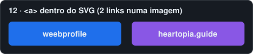

**1a'.** The same file from an external host (camo). Click it: GitHub opens the SVG in a new tab, where the buttons work:

**1b.** Two files glued together, each with its own `<a>` and `title` (fixed width of 415px each):

<a href="https://weebprofile-dashboard.pages.dev" title="WeebProfile">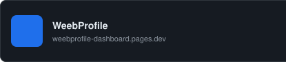</a><a href="https://heartopia.guide" title="Heartopia Guide">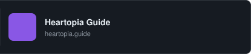</a>

**1c.** The same, with `width="50%"`:

**1d.** Stacked vertically (checks the gap between the lines):

 

## Part 3 · Animation

| # | Technique | Result |
|---|---|---|
| 01 | CSS `@keyframes` |  |
| 02 | SMIL | 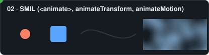 |
| 03 | Typing |  |
| 04 | Carousel |  |
| 05 | Odometer |  |
| 06 | `<script>` | 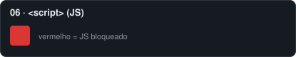 |
| 07 | `:hover` | 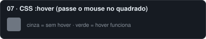 |
| 08 | foreignObject |  |
| 09 | GIF inside the SVG | 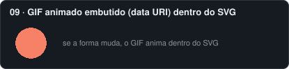 |
| 10 | External `<image>` | 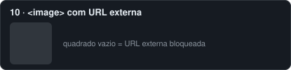 |
| 11 | `prefers-color-scheme` | 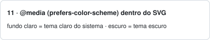 |
| — | Plain GIF |  |
| — | Animated WebP | 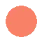 |

**External host (goes through GitHub's camo proxy, like WeebProfile's SVGs do):**

## Embed snippet (dashboard)

Snippets as the dashboard now copies them, pointing at two real half cards.

**4a.** Two halves, the "Side by side" snippet (`width="50%"`, tags glued):

**4b.** Three halves, same snippet (two on the first row, one on the second):

**4c.** One half alone, the per-card snippet (no `width`):

**4d.** Baseline, one half alone with `width="50%"`:

**4e.** Baseline, two halves glued without `width` (what combining the old snippets gave):

**4f.** Baseline, two halves at `width="50%"` with a line break between the tags:

  
  

## Auto theme (light/dark)

One SVG with both palettes: the light one by default, the dark one inside `@media (prefers-color-scheme: dark)`. It should follow GitHub's theme, not the OS.

**5a.** Terminal, auto, from the repo:

**5b.** The same file through camo (how WeebProfile's cards are served):

**5c.** Terminal dracula, auto, through camo:

**5d.** Default style, purple, auto, through camo (transparent card: text and accent change):

**5e.** Control, terminal without auto (always dark):

---

  

The above images are generated using [LucasHenriqueDiniz/WeebProfile](https://github.com/LucasHenriqueDiniz/WeebProfile)
