  

  
  
  

## 🛠️ Things I build

  <a href="https://weebprofile-dashboard.pages.dev/"></a
  ><a href="https://jikan.lucashdo.com/"></a
  >

  <a href="https://calculebrasil.com/"></a
  ><a href="https://dropcut.pages.dev/"></a
  >

  

## 📊 Stats

Every card here is made with <a href="https://github.com/LucasHenriqueDiniz/WeebProfile">WeebProfile</a> and refreshed every day.

<!-- The SVG lab that was here is in the history (up to 8d59949); its files stay in lab/. -->
